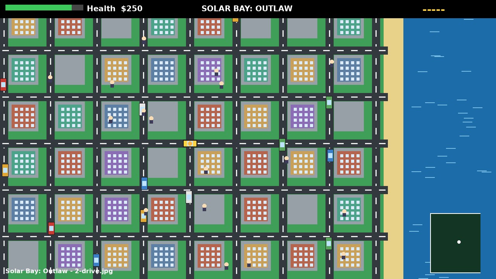

# Solar Bay: Outlaw

[](https://make.fun/bounty/gta6-01?utm_source=github&utm_medium=readme&utm_campaign=gta6-01)
[](https://make.fun/bounty/gta6-01/leaderboard?utm_source=github&utm_medium=readme&utm_campaign=gta6-01)
[](https://make.fun/bounty/gta6-01?utm_source=github&utm_medium=readme&utm_campaign=gta6-01)

Built for [make.fun](https://make.fun) — bounty gta6-01.

A 2D top-down open-world crime game that runs entirely in the browser.
Explore a seeded coastal city on foot or behind the wheel, dodge traffic
and pedestrians, punch and shoot your way through trouble, and outrun the
police as your wanted stars climb. Follow the five-mission Mara Voss story
chain, watch the HUD minimap, and save your progress locally.

## Features

- Seeded coastal city: road grid, city blocks, buildings, beach and water
- On-foot movement plus enterable vehicles with acceleration, braking, steering
- Traffic AI on the road grid and wandering pedestrians who flee from shots
- Wanted stars with police chase, busted and wasted outcomes
- Punch and pistol combat with damage and reactions
- 5-mission Mara Voss story chain with objectives and dialog
- HUD with wanted stars, health, money, minimap and current objective
- Title, pause, busted and wasted menu screens
- localStorage saves, WebAudio synthesized sound (engine, siren, gunshot, punch, pickup)
- Deterministic screenshot mode driven by `shots.json`

## How to run

Browser (Deno server):

```sh
deno run --allow-net --allow-read main.ts
```

Then open the served `game/index.html` page in your browser.
The Deno entry point in `main.ts` delegates to `serve.ts`, which serves
the static files under `./game`.

Headless (Node):

```sh
node main.ts
```

Runs a deterministic simulation: generates the city from a fixed seed,
simulates 600 ticks of traffic and pedestrian movement, and writes
`solar-bay-run.json` to `$MAKEFUN_OUTPUT_DIR` (or `/tmp`).

## Controls

- WASD / arrow keys: move / drive
- E: enter or exit a vehicle
- F: punch
- Mouse: aim and shoot

## Screenshots

- City overview: `screenshots/1-city.jpg`
- Driving: `screenshots/2-drive.jpg`
- Police chase: `screenshots/3-chase.jpg`
- Mission: `screenshots/4-mission.jpg`





## License

MIT — see LICENSE. No external assets; all sprites and sounds are procedural.
