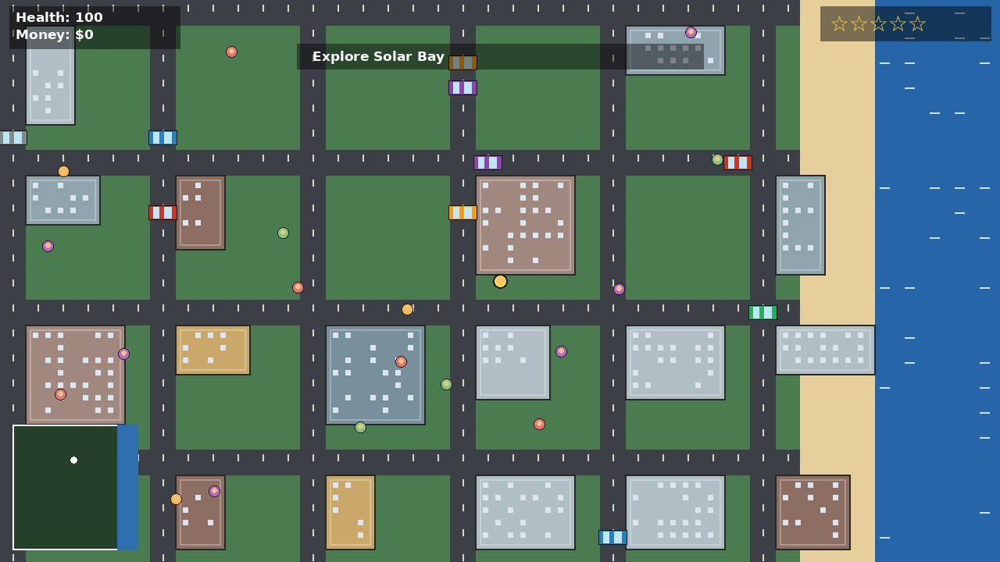
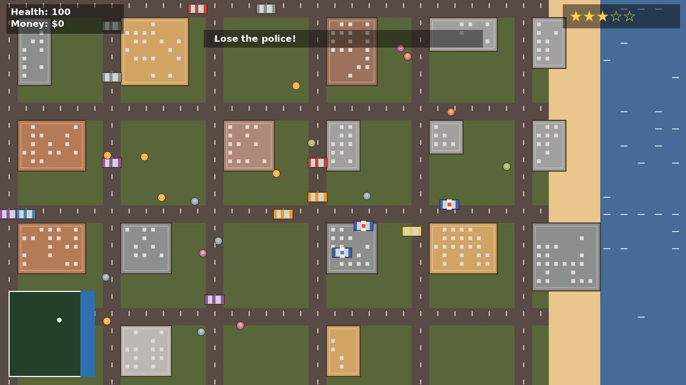
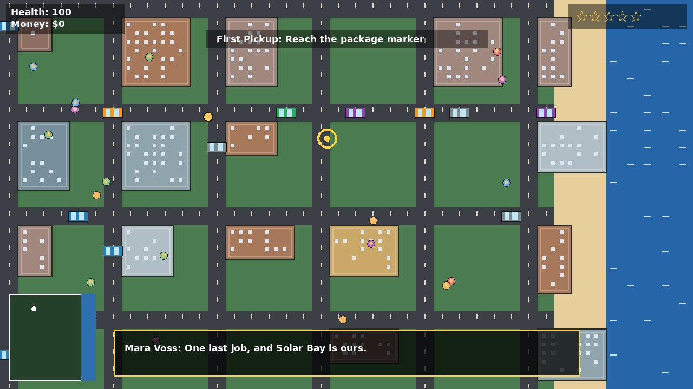

# Solar Bay: Outlaw

[](https://make.fun/bounty/gta6-01?utm_source=github&utm_medium=readme&utm_campaign=gta6-01)
[](https://make.fun/bounty/gta6-01/leaderboard?utm_source=github&utm_medium=readme&utm_campaign=gta6-01)
[](https://make.fun/bounty/gta6-01?utm_source=github&utm_medium=readme&utm_campaign=gta6-01)

A 2D top-down open-world crime game that runs entirely in the browser.
Built for [make.fun](https://make.fun) — no build step, no external assets,
no dependencies.

## The game

Solar Bay is a seeded coastal city: a road grid, blocks of buildings,
a beach and open water to the east. You roam it on foot or behind the
wheel while traffic cars follow the streets and pedestrians wander the
sidewalks — and scatter when shots are fired.

- **On-foot + driving** — walk with WASD/arrows, press E to enter or
  exit a car, drive with simple acceleration, braking and steering.
- **Traffic and pedestrian AI** — cars navigate the road grid,
  pedestrians wander and flee from danger.
- **Wanted system** — crimes raise your wanted stars. Police cars give
  chase; get cornered and you are **BUSTED**, lose all health and you
  are **WASTED**. Lay low and the stars fade.
- **Combat** — F to punch, mouse click to fire the pistol.
- **Story** — a 5-mission chain for Mara Voss, with objectives and
  dialog, from a simple pickup to the final getaway.
- **HUD** — wanted stars, health, money, objective text and a live
  minimap.
- **Menus** — title, pause, busted and wasted screens.
- **Saves** — progress is stored in `localStorage`.
- **Sound** — everything is synthesized with WebAudio: engine hum,
  siren, gunshot, punch and pickup blips. No audio files.
- **Deterministic screenshot mode** — `shots.json` defines named
  scenes (seed, player position, wanted level, time of day) so the
  screenshots below can be reproduced exactly.

## How to run

With Deno (recommended):

```sh
deno run --allow-net --allow-read main.ts
```

`main.ts` starts the static server in `serve.ts` on port 8000, serving
the `game/` folder. Then open http://localhost:8000/ in a browser.

Alternatively, open `game/index.html` directly in a browser, or serve
the `game/` folder with any static file server.

## Controls

| Key | Action |
| --- | --- |
| WASD / arrows | Move / drive |
| E | Enter or exit vehicle |
| F | Punch |
| Mouse click | Shoot pistol |
| P / Esc | Pause |

## Screenshots






## License

MIT — see `LICENSE`.

Solar Bay: Outlaw is an original work — all code, art and sound are
generated in this repository, with no third-party assets.
